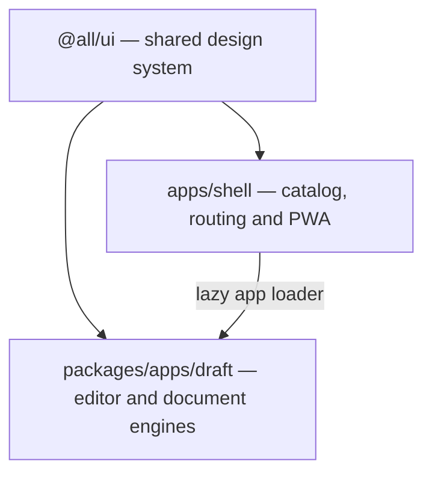

# AllSuite

<p align="center">
  <strong>A minimalist sketch-and-ink suite of browser-based office apps.</strong><br>
  No servers, no tracking, no accounts — client-side, offline-ready Progressive Web App (PWA).<br>
  Available in English and Polish.
</p>

<p align="center">
  <a href="LICENSE"></a>
  
  
  
  
  
</p>

---

## Table of Contents

- [Overview](#overview)
- [Why AllSuite](#why-allsuite)
- [Key Features](#key-features)
- [Apps Catalog](#apps-catalog)
  - [Draft Compatibility & Limitations](#draft-compatibility--limitations)
- [Architecture & Monorepo](#architecture--monorepo)
- [Responsive Layout Templates](#responsive-layout-templates)
- [Design System & Themes](#design-system--themes)
- [App API Contract](#app-api-contract)
- [Getting Started](#getting-started)
- [Adding a New App](#adding-a-new-app)
- [Storage & Privacy](#storage--privacy)
- [AI-assisted Development](#ai-assisted-development)
- [License](#license)

---

## Overview

**AllSuite** is a browser office suite for working with local documents. Its first app, **Draft**, is a rich-text editor with DOCX import and save, tables, images, references, physical pages and PDF export. Document processing happens on your device.

The project uses an npm workspaces monorepo, a Vite/React shell and the shared `@all/ui` design system used by AllTools and AllGames. Apps load on demand, keeping the editor and conversion engines out of the initial catalog bundle.

---

## Why AllSuite

Opening and editing a document should not require an account or uploading it to an online service. AllSuite provides a focused workspace for local files, with explicit saving and export, an offline app and a consistent interface across desktop and mobile.

---

## Key Features

- **Local document workflows**: Open DOCX, Markdown and plain text; save DOCX or export PDF, HTML, Markdown and text.
- **Rich-text editing**: Formatting, paragraph styles, nested lists, find/replace, tables, images and safe rich-text paste.
- **Physical pages**: Page setup, margins, page breaks, rich headers/footers, page numbering and single-column print preview.
- **Document references**: Headings, bookmarks, tables of contents, captions, cross-references, footnotes and endnotes.
- **Offline PWA**: Static app assets and bundled fonts are cached for offline use; documents stay in memory.
- **Four themes**: Dark, Light, E-Ink Light and E-Ink Dark, with reduced-motion support.
- **English and Polish**: Runtime language switching across the catalog and editor.
- **Responsive workspace**: A fixed toolbar and internally scrolling document pane across phones, tablets and desktops.

---

## Apps Catalog

| App       | Slug    | Category  | Key Capabilities                                                                                                                    |
| :-------- | :------ | :-------- | :---------------------------------------------------------------------------------------------------------------------------------- |
| **Draft** | `draft` | Documents | Rich-text editing, DOCX open/save, tables and images, references, headers/footers, print preview and PDF/HTML/Markdown/text export. |

### Draft Compatibility & Limitations

DOCX round trips preserve supported document semantics, including formatting, styles, lists, tables, embedded images, references and single-section page setup. The importer reports unsupported or flattened content before replacing the current document. Exact source layout, arbitrary fields, tracked changes, comments, macros, shapes and multiple-section layouts are not preserved. Supported charts are converted to static images.

Single-column editing, preview, Print and direct PDF share physical-page geometry. Multi-column exact preview/PDF and page-bottom footnotes are not implemented; notes appear at the document end. Direct PDF supports the bundled Latin/Latin Extended font coverage and produces selectable, untagged PDFs. Browser printer settings can change printed output.

The measured 100-page fixture meets the typing budget; the 300-page fixture exceeds it. This is a known performance limit, not a universal document-size limit.

---

## Architecture & Monorepo



### Directory Tree

```text
AllSuite/
├── package.json                  # Root workspaces, scripts and shared dependencies
├── apps/
│   └── shell/                    # Vite + React + TypeScript host and PWA
│       ├── src/apps/             # Eager metadata and lazy app loaders
│       ├── src/hooks/            # Shell hooks
│       ├── src/types/            # App metadata and component contracts
│       ├── src/                  # App, home page, theme setup and styles
│       ├── public/icons/         # Application icon
│       └── vite.config.ts        # Static hosting, PWA, CSP and bundle checks
├── packages/
│   └── apps/
│       └── draft/
│           └── src/              # Editor, browser adapters, engines and fonts
├── AllUI/                        # Git submodule providing @all/ui
├── licenses/                     # Third-party notices used by the app and PDF export
├── tests/                        # Browser workflows, fixtures and visual baselines
├── scripts/                      # License checks and development utilities
└── .github/workflows/            # Verification and GitHub Pages deployment
```

The metadata entry contains no editor or conversion imports. Draft's component, DOCX engine, worker, PDF renderer and document fonts load through separate lazy module graphs. The production build emits `bundle-report.json` and checks that heavy office dependencies do not enter the shell entry chunk.

---

## Responsive Layout Templates

AllSuite currently has one document-workspace layout rather than the multiple utility templates used by AllTools. Draft keeps its toolbar fixed while the document pane scrolls internally; on smaller screens, the workspace adapts without turning the whole page into a scrolling document. Shared controls, tokens and theme behavior come from `@all/ui`, while Draft owns its physical-page canvas and editor-specific layout.

---

## Design System & Themes

Shared components, icons, tokens and theme infrastructure come from `@all/ui`:

- **Design tokens**: Shared colors, typography, spacing, borders and motion values.
- **Dark and Light**: Screen themes with consistent controls and document workspace styling.
- **E-Ink Light and E-Ink Dark**: Monochrome themes with motion disabled.
- **Reduced motion**: Respects the operating system's `prefers-reduced-motion` setting.
- **Local fonts**: Interface and document fonts are bundled with the app; no external font service is required.

---

## App API Contract

Each app lives in `packages/apps/<slug>` and exposes separate metadata and runtime entry points:

```ts
// Eager catalog entry: no editor or conversion imports.
import { metadata } from '@allsuite/draft/metadata'

// Lazy runtime entry: exports AppComponent.
const app = await import('@allsuite/draft')
```

The shell provides the app with the current locale, e-ink state, optional header content and dirty-state callbacks:

```ts
export interface AppComponentProps {
  locale: 'en' | 'pl'
  isEink?: boolean
  setHeader?: (content: React.ReactNode) => void
  isDirty?: boolean
  setIsDirty?: (dirty: boolean) => void
}
```

The registry in `apps/shell/src/apps/registry.ts` connects catalog metadata to the lazy component loader. Apps report unsaved changes so the shell can protect navigation.

---

## Getting Started

### Prerequisites

- **Node.js**: `22`, matching CI.
- **npm** with workspace support.
- **Git** with submodules initialized.

### Installation & Run

```sh
git clone --recurse-submodules https://github.com/patrasxd/AllSuite.git
cd AllSuite
npm ci
npm ci --prefix AllUI
npm run dev
```

Development runs at `http://localhost:5176/AllSuite/`. Production preview uses port 4176.

### Scripts Reference

| Command                 | Description                                             |
| :---------------------- | :------------------------------------------------------ |
| `npm run dev`           | Start the development server                            |
| `npm run lint`          | Check code quality with ESLint                          |
| `npm run format:check`  | Check formatting with Prettier                          |
| `npm run typecheck`     | Check TypeScript across the shell and imported packages |
| `npm test`              | Run app unit and component tests                        |
| `npm run test:ui`       | Run the pinned AllUI test suite                         |
| `npm run license:check` | Check installed dependency licenses                     |
| `npm run build`         | Build the production app and bundle report              |
| `npm run preview`       | Preview the production build                            |
| `npm run test:e2e`      | Run Playwright browser and visual regression tests      |

Build AllUI with `npm run build --prefix AllUI`. Before browser tests, build AllSuite and install Chromium with `npx playwright install chromium`. On Windows, `PLAYWRIGHT_CHANNEL=msedge` selects installed Edge.

### Deployment

[GitHub Actions](.github/workflows/deploy.yml) deploys successful pushes to `main`:

1. Install locked dependencies and verify the pinned AllUI build/tests.
2. Run lint, formatting, TypeScript, app tests and dependency-license checks.
3. Build the production app and run browser tests.
4. Publish `apps/shell/dist` to `gh-pages` through `peaceiris/actions-gh-pages`.

GitHub Pages serves the `gh-pages` branch from `/(root)` using **Deploy from a branch**. The app's base path and PWA scope are `/AllSuite/`. Pull requests and pushes to `release-prep` run the [verification workflow](.github/workflows/verify.yml).

---

## Adding a New App

1. Create `packages/apps/<slug>` with a workspace manifest named `@allsuite/<slug>`.
2. Implement the app using shared `@all/ui` controls and semantic tokens.
3. Export lightweight metadata separately from the runtime `AppComponent`.
4. Register metadata and a dynamic loader in `apps/shell/src/apps/registry.ts`.
5. Report unsaved document state and keep document content in memory.
6. Add engine, component and browser tests, including themes and responsive layouts.

Follow [AGENTS.md](AGENTS.md) and the app-boundary rules in [`.agents/`](.agents/) for the full development contract.

---

## Storage & Privacy

Document text, images, metadata and file handles stay in memory. Documents are written to disk only through explicit save/export actions. There is no cloud storage, recent-document list, autosave or recovery; closing or reloading loses unsaved work. The editor displays unsaved state and requests the browser's leave-page warning.

Only small UI preferences, such as locale, theme, ruler visibility and image-insertion settings, use safe namespaced browser storage. The service worker caches static app assets, with no runtime document cache. Updates prompt the user rather than automatically reloading an unsaved editor.

There are no analytics, trackers, cookies, ads, CDNs or automatic third-party requests. Production builds restrict network connections to the same origin, blob and data URLs through a Content Security Policy. Local conversion workers process imported files without uploading them; unsafe links and remote images are rejected.

---

## AI-assisted Development

This project is built with AI coding agents under human direction. Repository instructions in [AGENTS.md](AGENTS.md) and [`.agents/`](.agents/) define the architecture, privacy rules, design constraints and testing requirements. Changes are reviewed by the author, and CI runs the required checks before deployment.

---

## License

This project is licensed under the [MIT License](LICENSE). Third-party packages and bundled fonts retain their notices in [THIRD_PARTY_LICENSES.md](THIRD_PARTY_LICENSES.md) and the distributed license asset.
